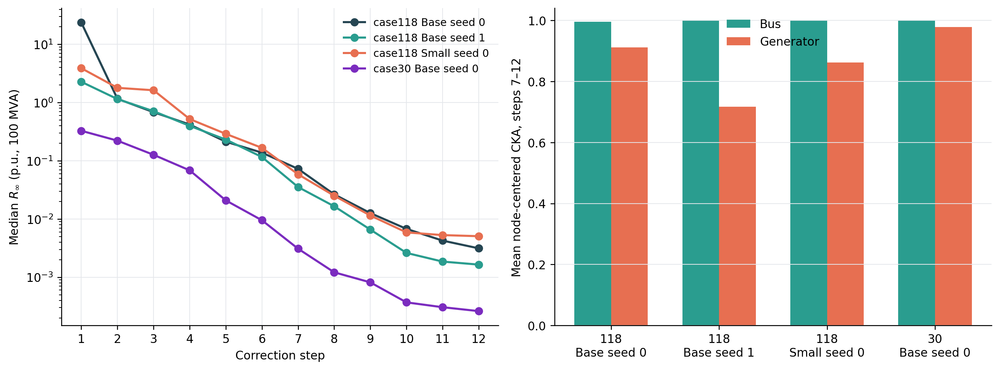
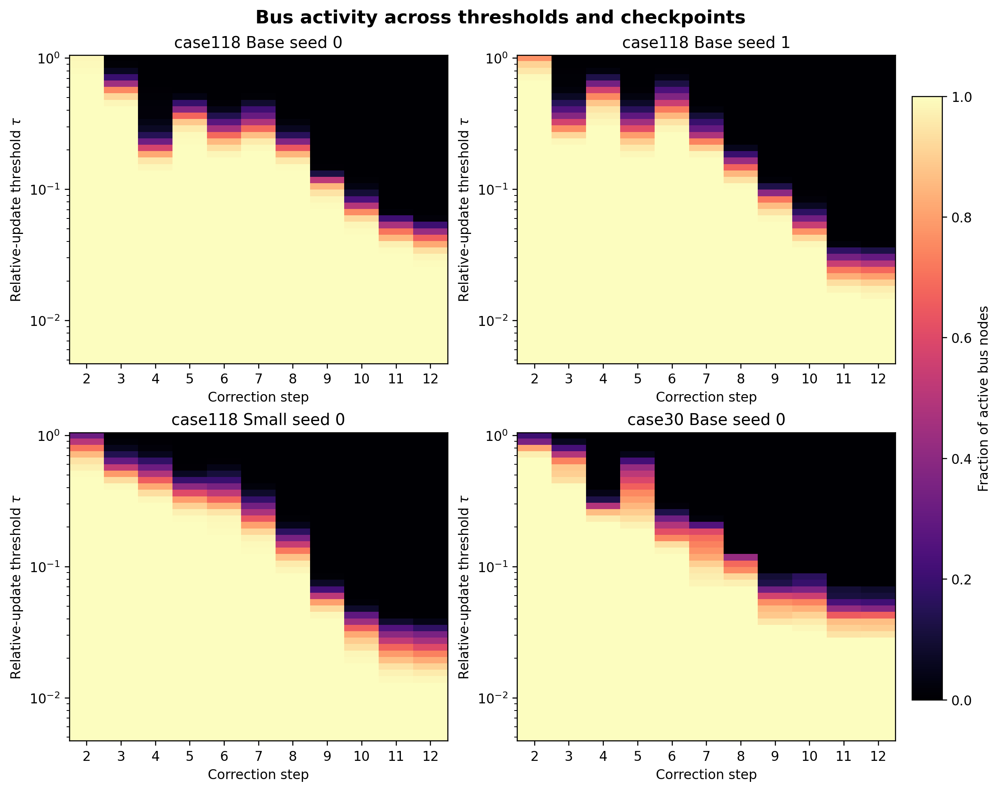

# Inside GENCO's 12 Correction Steps

This public package contains the compact, reproducible core of an effective-depth study of released GENCO power-flow checkpoints. It follows hidden states and physical residuals through all 12 corrections, measures correction importance through causal bypasses, compares fixed-budget compute policies, and maps node-level state activity.

## Main result

A correction can preserve representation geometry while remaining important to the final physical solution. In the primary case118 checkpoint, bus-state CKA reaches `0.999948` at correction 11, while bypassing that correction still increases final power-balance residual. Node-level measurements add spatial detail: with relative-update threshold `0.05`, `62.3%` of bus nodes remain active at correction 11 and `32.8%` remain active at correction 12.





The analysis covers four released checkpoints and 115 fixed-connectivity operating conditions per checkpoint:

- case118 Base, seeds 0 and 1
- case118 Small, seed 0
- case30 Base, seed 0

## Repository contents

- `src/genco_depth/`: tracing, similarity, intervention, trajectory, and compute-policy primitives
- `scripts/`: asset download, checkpoint evaluation, cross-checkpoint summarization, and environment setup
- `configs/checkpoints.yaml`: the four evaluated checkpoints and their frozen selections
- `assets/manifests/`: exact public asset revisions, file sizes, and hashes
- `assets/operating-conditions/`: frozen case118 and case30 condition IDs, topology coverage, and stable-node metadata
- `results/`: compact machine-readable summaries
- `figures/`: publication-ready figures grouped by scientific content
- `docs/`: research summary, node-activity analysis, and reproduction guide
- `tests/`: unit tests for integrity, identities, metrics, interventions, and statistics
- `vendor/graphkit-source.json`: exact upstream source revision and file hashes

Checkpoint weights, raw Parquet shards, and full per-node output tables are downloaded or regenerated. This keeps the repository compact while preserving exact provenance.

## Quick start

Python 3.10–3.12 is supported. The commands below use CPU inference.

```bash
bash scripts/setup_vendor.sh
bash scripts/setup_env.sh cpu

.venv/bin/python scripts/download_assets.py \
  --lock assets/manifests/case118-assets.lock.json --scope full
.venv/bin/python scripts/download_assets.py \
  --lock assets/manifests/cross-network-assets.lock.json --scope full

for variant in \
  case118_base_seed0 case118_base_seed1 \
  case118_small_seed0 case30_base_seed0
do
  .venv/bin/python scripts/run_trajectory_analysis.py --variant "$variant"
done

.venv/bin/python scripts/summarize_trajectory_analysis.py
.venv/bin/python -m unittest discover -s tests -v
```

The complete workflow, output schema, and expected files are described in [docs/reproducibility.md](docs/reproducibility.md). A concise interpretation appears in [docs/research-summary.md](docs/research-summary.md).

## Evaluation boundary

The reported evidence uses released checkpoints, fixed-connectivity operating-condition families, CPU FP32 forward passes, and FP64 research metrics. The causal bypass experiment measures dependence within the remaining correction chain. Node activity supplies a candidate compute budget; a production node-gating implementation still needs sparse edge execution, quality controls, and timing measurements.

## Upstream provenance

GENCO checkpoints, datasets, and `gridfm-graphkit` come from the public `gridfm` releases recorded in the asset manifests and `vendor/graphkit-source.json`. Their recorded license is Apache-2.0. See [THIRD_PARTY_NOTICES.md](THIRD_PARTY_NOTICES.md).
