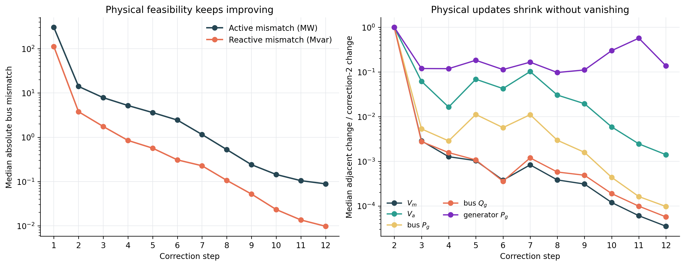

# Inside GENCO: Stage-Specific Computation in a Learned Physics Solver

This repository asks whether GENCO's 12 corrections repeat one stationary rule or implement a stage-specific learned correction schedule around a shared physics-feedback loop. It traces released checkpoints, measures physical refinement, intervenes on complete corrections, and tests whether correction blocks learned for different depths are interchangeable.

## Main findings

GENCO is a hybrid shared/untied architecture: the physics feedback, decoder, and output heads are shared, while each correction has its own graph Transformer and LayerNorm. In case118 Base, strict sharing of the compatible corrections 2–12 would reduce unique parameters from `20,069,187` to `2,094,147` (9.58×), without changing the 12-call computation graph.

The released checkpoints enter a locally stable latent regime before physical refinement is finished. In the primary checkpoint, mean node-centered bus CKA over corrections 7–12 is `0.9957`, yet median final power-balance residual continues from `0.0727` after correction 7 to `0.00313` after correction 12. Bypassing late corrections still damages the final solution. Thus high CKA is a useful global trajectory descriptor, but not a reliable local late-stage importance criterion.

Cross-correction substitution gives the sharper architecture result. For every shape-compatible target/source pair in corrections 2–12, replacing the target graph Transformer and LayerNorms with those from another depth increases mean final residual. The unchanged diagonal is best for all 11 targets; across 110 off-diagonal cells, median damage is `0.371` p.u. This supports stage-specific functional specialization of the correction blocks in the released untied checkpoint.





The analysis covers four released checkpoints and 115 fixed-connectivity operating conditions per checkpoint:

- case118 Base, seeds 0 and 1
- case118 Small, seed 0
- case30 Base, seed 0

## Repository contents

- `src/inside_genco/`: tracing, intervention, similarity, trajectory, and trainable tied-tail controls
- `scripts/`: asset download, checkpoint evaluation, cross-checkpoint summarization, and environment setup
- `configs/checkpoints.yaml`: the four evaluated checkpoints and their frozen selections
- `assets/manifests/`: exact public asset revisions, file sizes, and hashes
- `assets/operating-conditions/`: frozen case118 and case30 condition IDs, topology coverage, and stable-node metadata
- `results/`: compact machine-readable summaries
- `figures/`: publication-ready figures grouped by scientific content
- `docs/`: research summary, training protocol, and reproduction guide
- `tests/`: unit tests for integrity, identities, metrics, interventions, and statistics
- `vendor/graphkit-source.json`: exact upstream source revision and file hashes

Checkpoint weights, raw Parquet shards, and full per-node output tables are downloaded or regenerated. This keeps the repository compact while preserving exact provenance.

## Quick start

Python 3.10–3.12 is supported. The commands below use CPU inference.

```bash
bash scripts/setup_vendor.sh
bash scripts/setup_env.sh cpu

.venv/bin/python scripts/download_assets.py \
  --lock assets/manifests/case118-assets.lock.json --scope full
.venv/bin/python scripts/download_assets.py \
  --lock assets/manifests/cross-network-assets.lock.json --scope full

for variant in \
  case118_base_seed0 case118_base_seed1 \
  case118_small_seed0 case30_base_seed0
do
  .venv/bin/python scripts/run_trajectory_analysis.py --variant "$variant"
done

.venv/bin/python scripts/summarize_trajectory_analysis.py
.venv/bin/python scripts/run_operator_substitution.py --variant case118_base_seed0 --batch-size 115
.venv/bin/python scripts/summarize_operator_substitution.py
.venv/bin/python scripts/report_parameter_sharing.py
.venv/bin/python -m unittest discover -s tests -v
```

The complete workflow, output schema, and expected files are described in [docs/reproducibility.md](docs/reproducibility.md). The matched three-architecture, three-seed training protocol is in [docs/training-controls.md](docs/training-controls.md). A concise interpretation appears in [docs/research-summary.md](docs/research-summary.md).

## Evaluation boundary

The released-checkpoint evidence can establish functional specialization and non-interchangeability, but cannot by itself prove that untied training is better than recurrent sharing: a fair trained tied baseline is required for that claim. The included tied-tail model variants and configs make that next test explicit. Correction 12 is measured at its graph/readout endpoint; its subsequent feedback is excluded because no later correction consumes it.

## Upstream provenance

GENCO checkpoints, datasets, and `gridfm-graphkit` come from the public `gridfm` releases recorded in the asset manifests and `vendor/graphkit-source.json`. Their recorded license is Apache-2.0. See [THIRD_PARTY_NOTICES.md](THIRD_PARTY_NOTICES.md).
