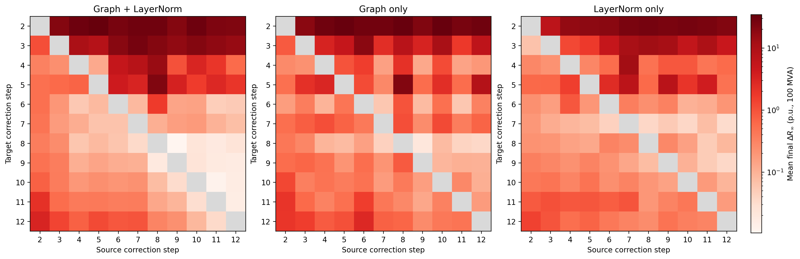

# Inside GENCO: Stage-Specific Computation in a Learned Physics Solver

This project conducts an inference-only study on the computation inside [GENCO](https://arxiv.org/abs/2608.09921). GENCO shares its output heads, physics decoder, and residual-to-latent feedback, while each of its 12 corrections has a separate graph Transformer and bus/generator LayerNorm. We explore waht those correction blocks do to get a feasible solution, and whether they perform interchangeable iterations or specialized refinement stages.

## Findings

- **Latent stabilization precedes physical convergence.** In case118 Base seed 0, mean node-centered bus CKA over corrections 7–12 is 0.9957, while median power-balance residual falls from 0.0727 after correction 7 to 0.00313 after correction 12.
- **Stable geometry does not imply low importance.** Whole-correction bypass still damages the final solution. CKA change correlates with bypass damage across the full trajectory, but is unreliable as a local late-stage criterion in the primary checkpoint.
- **Correction blocks are stage-specialized.** In the primary checkpoint, all 110(11x11-11) non-identical substitutions of correction blocks increase mean final residual.



Trajectory and bypass analyses cover four released checkpoints: case118 Base seeds 0/1, case118 Small seed 0, and case30 Base seed 0, each on 115 frozen fixed-connectivity operating conditions. Operator substitution covers case118 Base seed 0. These results support functional specialization within the released model.

## Reproduce

Python 3.10–3.12 is supported. Here we set up CPU inference and download the pinned assets:

```bash
bash scripts/setup_vendor.sh
bash scripts/setup_env.sh cpu
.venv/bin/python scripts/download_assets.py --lock assets/manifests/case118-assets.lock.json --scope full
.venv/bin/python scripts/download_assets.py --lock assets/manifests/cross-network-assets.lock.json --scope full
```

See [reproducibility.md](docs/reproducibility.md) for experiment commands and [research-summary.md](docs/research-summary.md) for the evidence and figures.

GENCO checkpoints, datasets, and `gridfm-graphkit` come from the public releases pinned in the manifests and `vendor/graphkit-source.json`.
