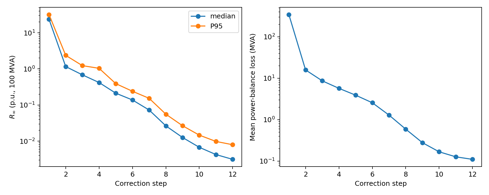
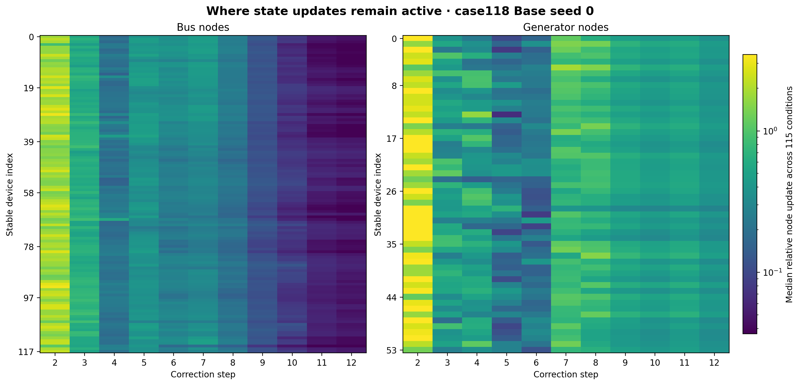
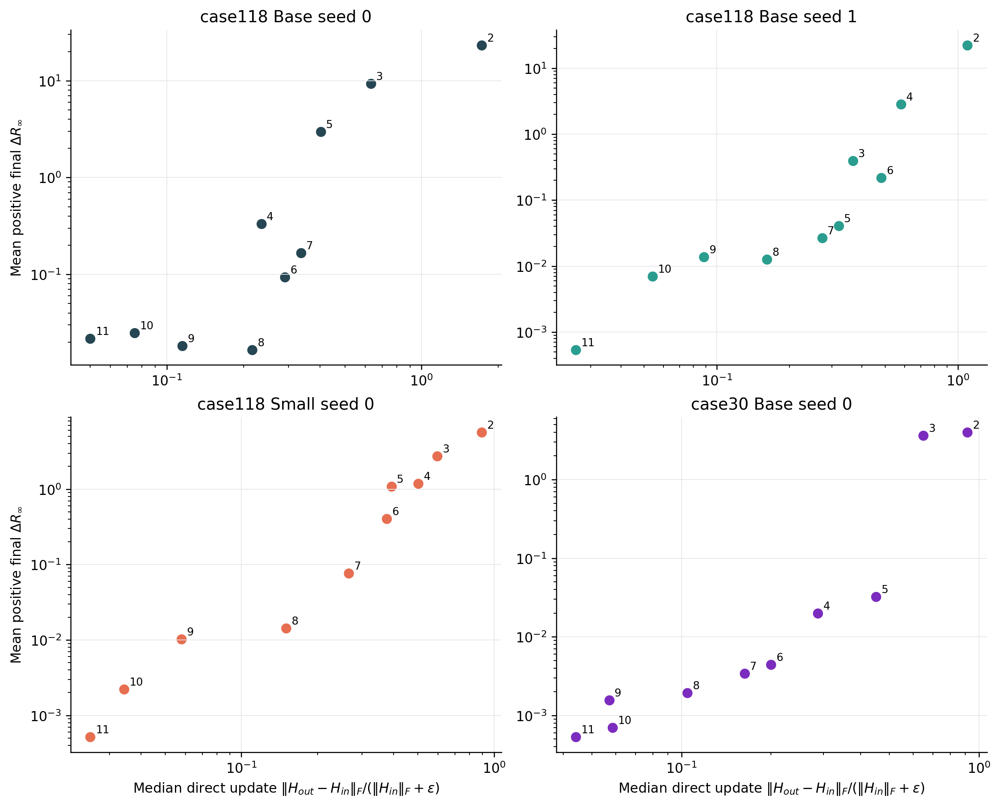

# Research summary: Inside GENCO's 12 correction steps

> **Core finding — A correction can remain functionally important even when its representation barely changes.**

## Problem

GENCO produces a power-flow solution through 12 consecutive corrections. We study two questions:

1. How do the hidden states and intermediate physical solutions evolve across the 12 corrections?
2. How well do representation geometry and direct update size predict a correction's contribution to the final solution?

## Method

Our primary experiment uses the released case118 Base, seed 0 checkpoint on 115 operating conditions from one fixed-connectivity family. We repeat the analysis with case118 Base seed 1, case118 Small seed 0, and case30 Base seed 0. The two case118 controls use the same 115 conditions. The case30 control uses 115 conditions from one fixed-connectivity family. Base has hidden width 48; Small has hidden width 24.

Each correction contains one graph-transformer update, followed by physical-solution decoding and a power-balance feedback update. We record the bus and generator hidden states, decoded voltages and branch flows, and bus power imbalance after every correction.

We summarize physical feasibility with `R∞`, the largest active- or reactive-power imbalance at any bus on a 100 MVA base. Linear CKA measures the similarity of representation geometry. A separate direct relative update measures vector movement:

`||Hout − Hin||F / (||Hin||F + ε)`.

For cross-correction CKA, we subtract each node's mean feature over operating conditions to focus the comparison on operating-state variation after controlling for stable node identity.

For the second question, the CKA-based local score is `1 − CKA` between the input and output bus states of one correction during normal inference. We ablate corrections 2–11 one at a time by replacing the complete correction with an identity map on both bus and generator states. This skips its graph Transformer, solution readout, branch-flow and physics decoding, power-balance residual, and encoded feedback. Correction 1 changes hidden width, while correction 12 owns the returned readout. The measured damage is the response of the **remaining correction chain**, including the effect of downstream distribution shift.

All trajectory, direct-update, and ablation summaries use 115 operating conditions per checkpoint. Overall rank associations contain 10 step-level observations (corrections 2–11); late-stage associations contain five (7–11). We use 2,000 paired bootstrap resamples of operating conditions to quantify how ablation-damage ranks change, keeping pooled CKA fixed and recomputing direct-update summaries within each resample.

## 1. How do the hidden states and physical solution evolve?

*Figure 1 — Median and P95 bus power imbalance after each correction for case118 Base seed 0.*

For case118 Base seed 0, the median `R∞` falls from **23.6794** after correction 1 to **1.1603** after correction 2, then reaches **0.4193** after correction 4, **0.02649** after correction 8, and **0.003134** after correction 12. The first corrections make the large adjustment; the remaining corrections refine the solution.

Across individual operating conditions, **55 of 115** contain at least one adjacent increase in `R∞`. These temporary increases occur inside trajectories that reach a lower final error.

*Figure 2 — Pairwise CKA between correction steps for case118 Base seed 0, before and after removing each node's mean feature.*

Bus representations change substantially in the early corrections and form a high-similarity block over corrections 7–12. After node centering, the mean off-diagonal CKA within this block is **0.9957** for buses. Generator states remain more dynamic over the same corrections, with a mean CKA of **0.9118**.

*Figure 3 — Median physical trajectory and steps 7–12 node-centered CKA for the four checkpoints.*

The coarse-to-fine pattern repeats in the three added controls. Their median `R∞` also decreases across all 12 corrections, and their late bus CKA ranges from **0.9986** to **0.9996**. The generator result varies more: late generator CKA is **0.7173** for case118 Base seed 1, **0.8624** for case118 Small seed 0, and **0.9777** for case30 Base seed 0. The number of conditions with at least one temporary worsening is **55**, **68**, **97**, and **62** in the four variants, respectively.

The repeated feature is a late regime with stable bus-state geometry and continued physical refinement. The generator trajectory and the frequency of non-monotone updates depend on the checkpoint and network.

To distinguish stable geometry from small node-wise movement, we also measure `||h_out−h_in||2/(||h_in||2+ε)` for every node and report the fraction above a threshold `τ` over corrections 2–12.

*Figure 4a — Fractions of bus and generator nodes above each relative-update threshold for case118 Base seed 0.*

At correction 10, whole-step bus CKA is already **0.999794**, while **98.9%** of bus nodes still move by more than `0.05`. At correction 11, CKA reaches **0.999948** and the corresponding fraction is still **62.3%**. High CKA therefore records preservation of representation geometry rather than node-wise immobility. The fraction falls to **32.8%** at correction 12. Every generator update in corrections 7–12 exceeds `0.20` in the same checkpoint, so bus and generator states follow different late-stage trajectories.

*Figure 4b — Color shows the fraction of bus nodes above each relative-update threshold.*

All four checkpoints shift toward smaller late-stage bus updates, but their absolute scales differ. At `τ=0.05`, the correction-12 fractions are **32.8%**, **0%**, **0%**, and **28.4%** for case118 Base seed 0, Base seed 1, Small seed 0, and case30 Base seed 0. A fixed threshold therefore does not select the same large-update regime across checkpoints.

*Figure 4c — Median relative update for each stable bus and generator identity over 115 conditions.*

The spatial ordering is much more reproducible than the thresholded fraction. For the three case118 checkpoints, pairwise Spearman correlations between per-bus median update magnitudes range from **0.912 to 0.981** at correction 11 and from **0.972 to 0.981** at correction 12. Within each checkpoint, the median correction-12 update is higher for PQ buses than for PV buses; the single REF bus lies below both groups. Late bus refinement is therefore spatially structured. Bus role is one possible contributor to this ordering, but the present observation does not establish causality.

## 2. How does local change relate to correction importance?

*Figure 5 — Each panel compares CKA geometry change during the normal trajectory with the final physical error introduced by ablating one correction.*

Across corrections 2–11, CKA geometry change and ablation effect are strongly related in all four variants. Their step-level Spearman correlations are **0.855**, **0.927**, **0.952**, and **0.988** for case118 Base seed 0, case118 Base seed 1, case118 Small seed 0, and case30 Base seed 0. Operating-condition bootstrap intervals are respectively **[0.855, 0.867]**, **[0.927, 0.939]**, **[0.903, 0.952]**, and **[0.976, 0.988]**. These intervals quantify damage-rank stability conditional on each pooled CKA score; the independent step-level sample size remains ten.

Late-stage ranking tells a different story. In case118 Base seed 0, correction 11 has the smallest CKA change, while correction 8 has the smallest ablation effect. From correction 8 to correction 11, `1 − CKA` falls from **0.00434** to **0.0000524**, while the mean final `R∞` increases are **0.01669**, **0.01827**, **0.02495**, and **0.02169**. Restricted to corrections 7–11, Spearman drops to **0.10** with a conditional bootstrap interval of **[0.10, 0.20]**. The large early-step effects account for most of the full-chain correlation; late-step selection benefits from intervention evidence.

*Figure 6 — Direct relative bus-state update norm versus ablation damage, separating vector movement from CKA geometry.*

Direct distance yields the same pattern. In case118 Base seed 0, the median relative bus update falls from **0.2165** at correction 8 to **0.0501** at correction 11—a **4.3×** reduction—while ablation damage rises from **0.01669** to **0.02169**. Among the 29 operating conditions in the smallest-update quartile at correction 11, **29/29** have positive damage, with median `ΔR∞ = 0.02086`. Across all ten corrections, direct-update/damage Spearman values are **0.855**, **0.976**, **1.000**, and **0.988**; for corrections 7–11 they are **0.10**, **0.90**, **1.00**, and **0.90**. The late-stage mismatch is strongest in the primary checkpoint.

Local change describes the stability of the current representation. Ablation damage captures the correction's value to the remaining computation chain.

## Practical check: selecting a correction under a fixed budget

We tested this implication under a separate frozen exploration/confirmation protocol. With one skipped correction, CKA selects correction 11, while exploration-side intervention damage selects correction 8. On 51 untouched confirmation conditions, mean positive `ΔR∞` is **0.02268** for the CKA choice and **0.01750** for the intervention-guided choice; the paired advantage is **0.00519**, 95% CI **[0.00202, 0.00744]**. Both execute 11 corrections and the intervention-guided path gives **1.10×** measured end-to-end speedup. With two skipped corrections, the global-versus-local advantage interval crosses zero, indicating material interaction between corrections.

For the studied checkpoint, functional intervention provides the stronger single-step selection signal. Operational early exit would additionally require per-condition control and safety validation.

## Conclusion

Across two seeds, two model widths, and two network sizes, the studied GENCO checkpoints follow a coarse-to-fine physical trajectory and enter a late regime with highly similar bus-state geometry. That geometry can remain nearly unchanged while most bus nodes still move, and the late update magnitudes form a reproducible spatial ordering on the same grid. Generator states follow a separate trajectory. CKA and direct update norms track functional importance across the full correction chain; the primary checkpoint shows that this ordering can disappear among late corrections. A correction may remain functionally important after its representation has nearly stabilized.
