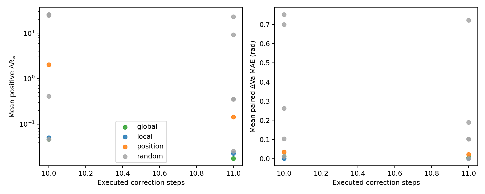

# Research summary

## Questions

The study follows two questions through GENCO's 12 correction steps:

1. How do hidden states and intermediate physical solutions evolve?
2. How well do representation similarity and direct update size predict a correction's contribution to the final solution?

Each correction contains a graph update, a physical-solution decoder, a power-balance residual, and encoded feedback. The trace records bus and generator hidden states, decoded outputs, and bus power imbalance after every correction.

`R∞` is the largest active- or reactive-power imbalance at any bus on a 100 MVA base. Linear CKA measures representation geometry. Direct movement is measured by

`||Hout − Hin||F / (||Hin||F + ε)`.

Corrections 2–11 are bypassed one at a time. Each bypass maps bus and generator states directly to the next correction and skips the associated decoder and feedback computation. The final residual measures the response of the remaining chain.

## Coarse-to-fine physical correction

For case118 Base seed 0, median `R∞` falls from `23.6794` after correction 1 to `1.1603` after correction 2, `0.02649` after correction 8, and `0.003134` after correction 12. All four checkpoints show the same broad coarse-to-fine trajectory.

Individual trajectories contain temporary increases. The four checkpoints have 55, 68, 97, and 62 operating conditions with at least one adjacent increase. Later corrections can reshape an intermediate solution before reaching a lower final error.

## Representation geometry and functional importance

Case118 Base seed 0 enters a high-similarity bus-state regime over corrections 7–12. Mean node-centered off-diagonal CKA is `0.9957` for buses and `0.9118` for generators.

Across corrections 2–11, CKA change and bypass damage have Spearman correlations of `0.855`, `0.927`, `0.952`, and `0.988` across the four checkpoints. In the primary checkpoint, the correlation over corrections 7–11 falls to `0.10`. Correction 11 has the smallest CKA change; correction 8 has the smallest bypass damage.

Direct hidden-state movement shows the same primary-checkpoint ranking gap. Median relative bus update falls from `0.2165` at correction 8 to `0.0501` at correction 11, while mean positive final `ΔR∞` rises from `0.01669` to `0.02169`.

## Fixed-budget compute allocation

A frozen exploration cohort selects correction 8 from intervention damage and correction 11 from CKA. On 51 untouched confirmation conditions, mean positive `ΔR∞` is `0.01750` for correction 8 and `0.02268` for correction 11. The paired advantage is `0.00519`, with 95% interval `[0.00202, 0.00744]`. The correction-8 policy executes 11 corrections and reaches `1.10×` measured end-to-end speedup on CPU.

With two skipped corrections, the global-versus-local advantage interval includes zero. Interactions between corrections become material at the larger budget.

## Node-level activity

For every node, the experiment records

`r(s,i,v) = ||h_out(s,i,v) − h_in(s,i,v)||2 / (||h_in(s,i,v)||2 + 1e−12)`.

At threshold `0.05`, active bus fractions in the primary checkpoint are `98.9%`, `62.3%`, and `32.8%` at corrections 10, 11, and 12. Generator updates in corrections 7–12 all exceed `0.20`. Late compute reuse is concentrated in bus states.

The correction-12 active bus fractions at threshold `0.05` are `32.8%`, `0%`, `0%`, and `28.4%` across the four checkpoints. Each checkpoint therefore needs its own calibrated gate.

Within case118, per-bus median update rankings remain stable across checkpoints: pairwise Spearman correlations range from `0.912` to `0.981` at correction 11 and from `0.972` to `0.981` at correction 12. This gives a reproducible spatial signal for future sparse execution.

## Scope

The evidence covers two seeds, two model widths, two network sizes, and one fixed-connectivity family per checkpoint. Future evaluation can add topology-changing conditions and a true node-and-edge sparse execution path.
