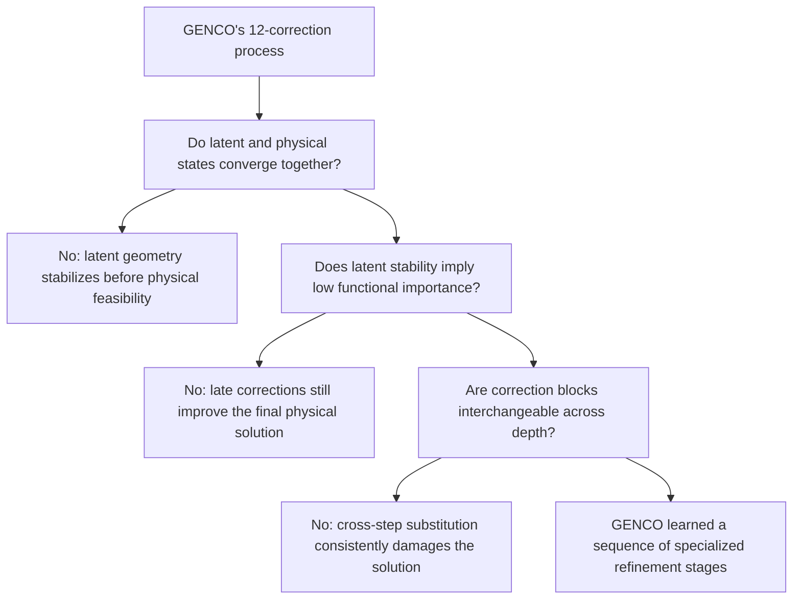

# Inside GENCO: Stage-Specific Computation in a Learned Physics Solver

GENCO solves power flow through a sequence of 12 corrections. Although the output heads, physics decoder, and residual-to-latent feedback MLP are shared across steps, each correction has its own graph Transformer and bus/generator LayerNorm parameters. An obvious alternative would be to apply a single shared correction block recurrently after the initial width-changing stem. Such a design would be more parameter-efficient and could, in principle, support a flexible number of refinement steps. This contrast motivates our central question: does GENCO merely apply a stationary correction rule to a changing state, or has it learned a stage-specific correction schedule in which different depths perform distinct refinement functions?

This question separates into three testable parts:

1. Do latent representations and physical variables converge at the same time?
2. Does small local representation change imply that a correction is functionally unimportant?
3. Are the correction blocks learned at shape-compatible depths interchangeable?

The third question is essential. Different behavior at different depths does not by itself demonstrate parameter specialization, because a shared operator can produce different effects on different input states.

## Mechanistic evidence overview

## Evidence 1: latent stabilization precedes physical convergence

The primary experiment uses the released case118 Base seed-0 checkpoint on 115 fixed-connectivity operating conditions. Controls cover case118 Base seed 1, case118 Small seed 0, and case30 Base seed 0, each on 115 conditions.

*Figure 1 — Median active/reactive bus mismatch and adjacent decoded-variable movement for case118 Base seed 0.*

For case118 Base seed 0, median maximum power-balance residual falls from **23.6794** after correction 1 to **1.1603** after correction 2, **0.07267** after correction 7, and **0.003134** after correction 12. Median active bus mismatch falls from **1.152 MW** after correction 7 to **0.0885 MW** after correction 12; reactive mismatch falls from **0.2268 Mvar** to **0.00973 Mvar**. Voltage and bus-injection movements shrink strongly, while generator active-power adjustments remain stage-dependent rather than decaying monotonically.

*Figure 2 — Pairwise CKA between corrections for the primary checkpoint, before and after removing each node's mean feature.*

The bus representation enters a high-similarity regime over corrections 7–12. Mean off-diagonal node-centered CKA is **0.9957** for buses, while generator CKA is **0.9118**. The latent representation therefore stabilizes before physical feasibility has converged. This is more precise than saying only that CKA is high while later corrections remain useful.

*Figure 3 — Median physical trajectory and late node-centered CKA for released checkpoints.*

The coarse-to-fine physical trajectory and late bus-similarity regime recur across seeds, model widths, and network sizes. Generator behavior and temporary non-monotonicity vary more across checkpoints.

## Evidence 2: local change cannot imply importance

Corrections 2–11 are bypassed one at a time as complete computational units: graph update, readout, physics decoding, residual, and feedback. Correction 1 cannot be bypassed because it changes latent width, while correction 12 owns the returned readout. Bypass damage therefore measures a correction's contribution within the remaining computation chain rather than the standalone quality of an isolated block.

*Figure 4 — CKA geometry change along the normal trajectory versus mean positive final residual damage from a whole-correction bypass.*

Across the full corrections 2–11 trajectory, CKA change and bypass damage are strongly associated in all checkpoints. In the primary checkpoint, their step-level Spearman correlation is **0.855**. Restricted to late corrections 7–11, however, it falls to **0.10**: correction 11 has the smallest CKA change, whereas correction 8 has the smallest bypass damage.

We may conclude that CKA captures correction importance over the global trajectory but fails as a local late-stage criterion, so it should not be seen as a general importance predictor.

## Evidence 3: learned correction blocks are not interchangeable

For every target correction `t` and source correction `s` in 2–12, the operator-substitution experiment runs the normal chain while replacing the target's graph Transformer and both LayerNorms with those learned at the source depth. The diagonal is the unchanged checkpoint. This intervention preserves the state arriving at depth `t` and directly tests whether similar latent geometry also implies correction-block interchangeability.

*Figure 5 — Mean final residual damage when the target correction uses the source correction's graph Transformer and LayerNorms.*

The unchanged diagonal is best for **11/11** targets. Every one of the **110** off-diagonal substitutions increases mean final residual: the smallest increase is **0.0105 p.u.**, the median is **0.371 p.u.**, and the maximum is **34.54 p.u.** Even neighboring late correction blocks are not freely interchangeable.

This result supports functional specialization within the released untied checkpoint.

## Parameter-sharing implication

The released case118 Base model has **20,069,187** unique parameters. If correction 1 remains independent while corrections 2–12 share correction 2's graph operator and both LayerNorms, the same 12-call computation graph has **2,094,147** unique parameters, a **9.58×** reduction. Sharing the graph operator while retaining step-specific LayerNorms gives **2,109,507** parameters.

To establish an accuracy–parameter tradeoff, we need to train these alternative architectures from scratch: the original untied model, a strict recurrent-tail model, and a shared-graph model with step-specific LayerNorms. We began exploring this comparison but did not complete it because of the computational cost: training all three architectures with three seeds each was estimated to require several days of RTX 6000D GPU time.

## Conclusion

The evidence suggests that GENCO's 12 corrections are not interchangeable iterations of a stationary operator, but a learned sequence of specialized refinement stages. Bus latent geometry stabilizes before physical feasibility converges; late corrections can remain functionally important despite small representational change; and replacing a correction block with one learned at another depth consistently damages the final solution. An experiment to train GENCO of alternative architectures from scratch could answer whether this specialization also yields a better accuracy–parameter tradeoff than recurrent sharing.
