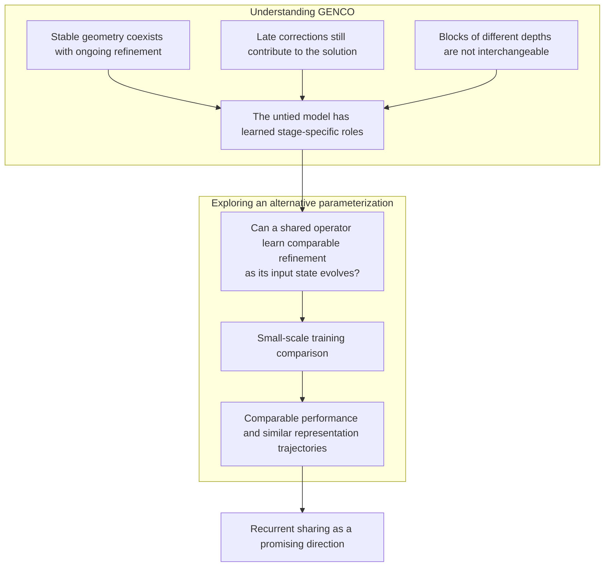
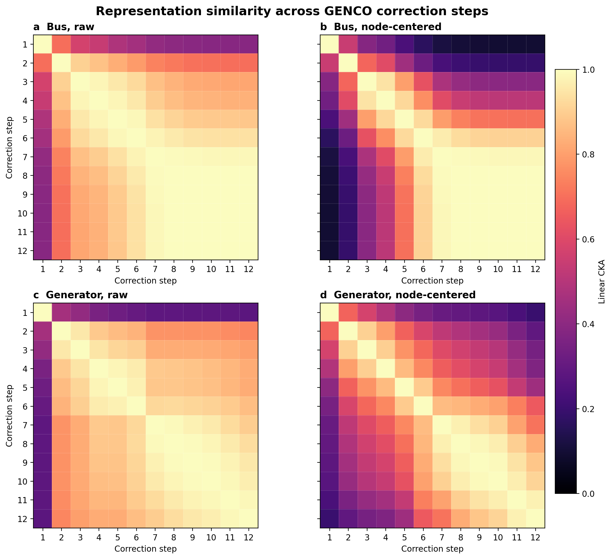
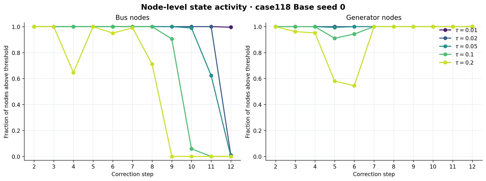
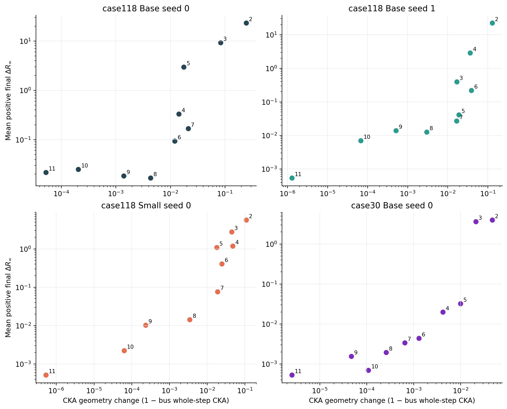
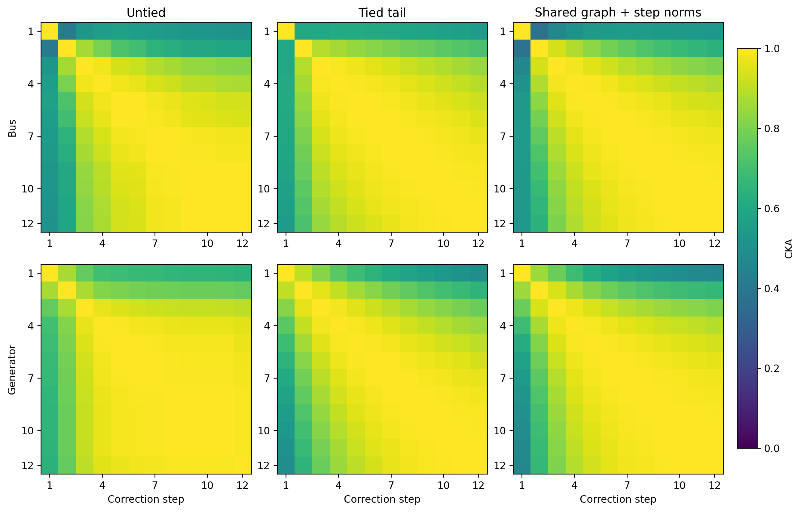

# Inside GENCO: Refinement Dynamics in a Learned Physics Solver

GENCO solves power flow through a sequence of 12 corrections. Although the output heads, physics decoder, and residual-to-latent feedback MLP are shared across steps, each correction has its own graph Transformer and bus/generator LayerNorm parameters. An obvious alternative would be to apply a single shared correction block recurrently after the initial width-changing stem. Such a design would be more parameter-efficient and could, in principle, support a flexible number of refinement steps. This contrast motivates our central question: does GENCO merely apply a stationary correction rule to a changing state, or has it learned a stage-specific correction schedule in which different depths perform distinct refinement functions?

This question separates into three testable parts:

1. Do latent representations and physical variables converge at the same time?
2. Does small local representation change imply that a correction is functionally unimportant?
3. Are the correction blocks learned at shape-compatible depths interchangeable?

The third question is essential. Different behavior at different depths does not by itself demonstrate parameter specialization, because a shared operator can produce different effects on different input states.

## Research overview

We first examine how the released untied model refines its solution, then ask whether comparable refinement can be learned with shared parameters.

## Evidence 1: latent geometry stabilizes before physical convergence

The primary experiment uses the released case118 Base seed-0 checkpoint on 115 fixed-connectivity operating conditions. Controls cover case118 Base seed 1, case118 Small seed 0, and case30 Base seed 0, each on 115 conditions.

*Figure 1 — Median active/reactive bus mismatch and adjacent decoded-variable movement for case118 Base seed 0.*

For case118 Base seed 0, median maximum power-balance residual falls from **23.6794** after correction 1 to **1.1603** after correction 2, **0.07267** after correction 7, and **0.003134** after correction 12. Median active bus mismatch falls from **1.152 MW** after correction 7 to **0.0885 MW** after correction 12; reactive mismatch falls from **0.2268 Mvar** to **0.00973 Mvar**. Voltage and bus-injection movements shrink strongly, while generator active-power adjustments remain stage-dependent rather than decaying monotonically.

*Figure 2 — Pairwise CKA between corrections for the primary checkpoint, before and after removing each node's mean feature.*

The bus representation enters a high-similarity regime over corrections 7–12. Mean off-diagonal node-centered CKA is **0.9957** for buses, while generator CKA is **0.9118**. Bus latent geometry therefore becomes highly similar across corrections while physical residuals continue to decrease.

*Figure 3 — Fraction of bus/generator nodes whose graph-block relative update exceeds each threshold, averaged equally over all conditions in the primary checkpoint.*

Node activity clarifies what this stabilization does—and does not—mean. For each node, we measure the relative update magnitude `||h_graph − h_in||₂ / (||h_in||₂ + 1e−12)` at corrections 2–12, consistently before physics feedback. Correction 1 is excluded because it changes feature width. Unlike cross-correction CKA, this measure asks how much each graph block moves its input, not how similar the geometry of successive graph outputs is.

At the 1% threshold, **100%** of bus nodes remain active at correction 11 and **99.55%** at correction 12. At the 5% threshold, both fractions are **0%**. Meanwhile, every generator node exceeds a 20% graph update throughout corrections 7–12. Thus, high late bus CKA coexists with widespread small node updates, while generators retain substantially larger relative updates. The apparent disappearance of bus activity at a higher threshold reflects diminishing update magnitude instead a set of completely inactive nodes.

*Figure 4 — Median physical trajectory and late node-centered CKA for released checkpoints.*

The coarse-to-fine physical trajectory and late bus-similarity regime recur across seeds, model widths, and network sizes. Generator behavior and temporary non-monotonicity vary more across checkpoints. Absolute node-activity fractions are also checkpoint- and threshold-dependent: the primary checkpoint's near-universal late bus activity at 1% is not a universal result across checkpoints. The multi-checkpoint activity summaries are retained in `results/node-activity-summary.csv`.

## Evidence 2: small local change can coexist with bypass damage

Corrections 2–11 are bypassed one at a time as complete computational units: graph update, readout, physics decoding, residual, and feedback. Correction 1 cannot be bypassed because it changes latent width, while correction 12 owns the returned readout. Bypass damage therefore measures a correction's contribution within the remaining computation chain rather than the standalone quality of an isolated block.

*Figure 5 — CKA geometry change along the normal trajectory versus mean positive final residual damage from a whole-correction bypass.*

Across the full corrections 2–11 trajectory, CKA change and bypass damage are strongly associated in all checkpoints. In the primary checkpoint, their step-level Spearman correlation is **0.855**. Restricted to late corrections 7–11, however, it falls to **0.10**: correction 11 has the smallest CKA change, whereas correction 8 has the smallest bypass damage.

These descriptive correlations suggest an association between CKA change and bypass damage over the full trajectory. The late-stage result covers only five corrections and does not establish CKA's reliability as a local importance criterion. Bypass damage measures sensitivity within the trained chain and may also reflect downstream distribution shift.

## Evidence 3: learned correction blocks are not interchangeable

For every target correction `t` and source correction `s` in 2–12, the operator-substitution experiment runs the normal chain while replacing the target's graph Transformer and both LayerNorms with those learned at the source depth. The diagonal is the unchanged checkpoint. This intervention preserves the state arriving at depth `t` and directly tests whether similar latent geometry also implies correction-block interchangeability.

*Figure 6 — Mean final residual damage when the target correction uses the source correction's graph Transformer and LayerNorms.*

The unchanged diagonal is best for **11/11** targets. Every one of the **110** off-diagonal substitutions increases mean final residual: the smallest increase is **0.0105 p.u.**, the median is **0.371 p.u.**, and the maximum is **34.54 p.u.** Even neighboring late correction blocks are not freely interchangeable.

This result suggests functional specialization within the released untied checkpoint.

## Parameter-sharing implication

The released case118 Base model has **20,069,187** unique parameters. If correction 1 remains independent while corrections 2–12 share correction 2's graph operator and both LayerNorms, the same 12-call computation graph has **2,094,147** unique parameters, a **9.58×** reduction. Sharing the graph operator while retaining step-specific LayerNorms gives **2,109,507** parameters.

With limited computational resources, we ran a small-scale training experiment on case118 Small: the original untied model, a recurrent tail sharing both graph operators and LayerNorms, and a shared-graph model retaining step-specific LayerNorms. All three used the same fixed 10% subsets of training and validation load groups, normalizer, losses, and 100-epoch budget, with two seeds each. Evaluation used the full test split and checkpoints selected by validation residual.

| Architecture | Unique parameters | Test PBE Mean, averaged over two seeds (MVA) |
| --- | ---: | ---: |
| Untied | 5,047,011 | 1.177 |
| Tied tail | 529,251 | 1.004 |
| Shared graph + step-specific norms | 536,931 | 1.057 |

The three architectures achieved comparable test performance in this limited training setting, with the shared variants using roughly one tenth of the parameters. Their representation trajectories were also similar: early corrections changed the geometry substantially, while later corrections entered a high-similarity regime.

*Figure 7 — Raw cross-correction CKA on the same 115 operating conditions. Each architecture uses its better seed by validation residual, which is all seed 1; rows show buses and generators.*

This connects naturally to recent work on looped Transformers in language modeling. [Reasoning with Latent Thoughts](https://arxiv.org/abs/2502.17416) shows that repeated shared layers can compete with deeper untied models on reasoning tasks, while [Loop, Think, & Generalize](https://arxiv.org/abs/2604.07822) explores deeper reasoning through additional inference-time recurrence. Our small-scale results make recurrent parameter sharing a promising direction for GENCO: preserving iterative refinement with fewer parameters, and exploring whether the number of correction steps can become an adjustable computation budget.

## Conclusion

GENCO’s correction blocks have learned stage-specific roles. Functional specialization exists in the untied model, but step-specific parameters may not be required to achieve comparable refinement performance. Our small-scale training experiment supports this distinction: recurrent-sharing variants achieve comparable performance and exhibit similar representation trajectories with roughly one tenth of the parameters. Together with recent progress in looped Transformers, these findings motivate exploring GENCO as a parameter-efficient recurrent physics solver.

## Metric glossary

Below lists a few metrics used in this research, as well as some related GENCO concepts. In the formulas below, $r_i^P$ and $r_i^Q$ are bus power-balance mismatches.

| Metric / term | Definition |
| --- | --- |
| Maximum power-balance residual, $R_\infty$ | Largest absolute active mismatch over non-REF buses or reactive mismatch over PQ buses, divided by the 100 MVA base: $R_\infty=\max(\max_{i\notin\mathrm{REF}}\lvert r_i^P\rvert,\max_{i\in\mathrm{PQ}}\lvert r_i^Q\rvert)/100$. |
| Active / reactive mismatch | Mean absolute power-balance mismatch over all buses, in MW / Mvar. |
| Combined imbalance (PBE) | Mean or maximum of $\sqrt{(r_i^P)^2+(r_i^Q)^2}$ over all buses, in MVA. |
| Voltage / angle error | Mean or maximum absolute prediction error against the target: voltage magnitude over PQ buses, in p.u.; reference-aligned voltage angle over non-REF buses, in radians. Reference-bus voltage error is recorded separately. |
| Adjacent physical movement | Mean absolute decoded-variable change between consecutive corrections, over buses or generators as appropriate. Angle changes are reference-aligned and wrapped to $[-\pi,\pi]$. |
| Latent states | $h_{\mathrm{in}}$: input to a correction; $h_{\mathrm{graph}}$: state after graph processing and residual addition; $h_{\mathrm{out}}$: state after physics feedback. |
| Linear CKA | Representation similarity: $\operatorname{CKA}(X,Y)=\lVert X^\top Y\rVert_F^2/(\lVert X^\top X\rVert_F\lVert Y^\top Y\rVert_F)$. Rows pool aligned condition–node pairs; columns are mean-centered before calculation. |
| Node-centered CKA | Before CKA, subtract each device's mean feature vector across conditions at each correction. |
| Local representation change | $1-\operatorname{CKA}(h_{\mathrm{in}},h_{\mathrm{out}})$ for bus states within a correction, without additional node centering. |
| Node activity | A node is active when $\lVert h_{\mathrm{graph}}-h_{\mathrm{in}}\rVert_2/(\lVert h_{\mathrm{in}}\rVert_2+10^{-12})>\tau$. Average the active fraction equally across conditions, separately for buses and generators. |
| Functional/net node update | The same relative-update calculation, using $h_{\mathrm{out}}$ at corrections 2–11 and $h_{\mathrm{graph}}$ at correction 12 because final feedback is not consumed. |
| Bypass damage | For each condition, subtract baseline final $R_\infty$ from final $R_\infty$ after skipping a correction. |
| Operator-substitution damage | Mean signed final $\Delta R_\infty$ after replacing the target's graph Transformer and both LayerNorms with those from another depth. |
| Spearman correlation | Correlation between the ranks of local representation change and mean positive bypass damage across steps. |
| Bootstrap confidence interval | Resample conditions with replacement 2,000 times, recompute damage means and Spearman correlation, and take the 2.5th–97.5th percentiles. CKA stays fixed, so the interval describes damage-sampling uncertainty conditional on the observed CKA. |
